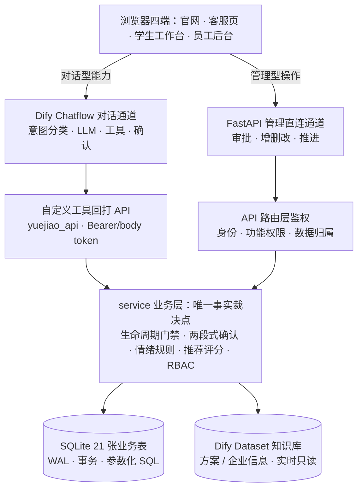

# ai服务智能助手 —— 项目深度技术解析

> 面向留学服务机构的智能体业务平台：企业官网获客 → 学生服务 → 员工运营 → 客服答疑，四端由 FastAPI + SQLite + Dify Chatflow 驱动。
>
> 本文基于源码与项目文档逐层深挖，覆盖技术栈、分层架构、数据流向、角色权限、数据表、业务状态机、AI/Dify 集成、安全机制，并在文末附 2 分钟面试介绍。

---

## 一、项目定位与技术栈

| 维度 | 内容 |
|---|---|
| 项目名 | ai服务智能助手（面向留学服务机构的智能体业务平台） |
| 业务闭环 | 企业官网获客 → 学生服务 → 员工运营 → 客服答疑，四端合一 |
| 后端 | FastAPI + 原生 sqlite3（无 ORM），单进程 `0.0.0.0:8000`，Python 3.10+（实测 3.13） |
| 前端 | 纯静态 HTML + 原生 JS，无构建、无 npm，由 FastAPI 同源托管 |
| 智能体 | Dify 1.10 Chatflow：3 张工作流 + 约 54 个自定义工具（口径 50/52/54 不一，以 OpenAPI 生成结果为准） |
| 数据 | SQLite 单文件 21 张业务表；知识库主数据不落库，实时读 Dify Dataset |
| 接口规模 | 97 个路由装饰器 + 2 个健康检查；文档另有 81/96 路径口径 |
| 测试 | `test_all.py` 确定性回归 221 项，加 `--dify` 共 236 项 |
| 依赖 | 见 `requirements.txt`：fastapi、uvicorn、pydantic 等（无 ORM、无 Redis、无 Celery） |

---

## 二、分层架构与职责

| 层 | 目录/文件 | 职责 | 关键机制 |
|---|---|---|---|
| 入口编排 | `backend/main.py` | 启动迁移、注册 13 个路由前缀、中间件、全局异常处理、静态托管 | 启动即跑 `ensure_migrations()` → `repair_application_consistency()` → `backfill_lifecycle_data()` |
| 路由层 | `backend/api/*.py`（14 个） | 参数校验（Pydantic）、鉴权调用、响应封装 | `format_data` 统一 `{code,msg,data}`；GET 用 Bearer，POST/PUT body 带 token |
| 业务层 | `backend/service/*.py`（16 个） | 真正的规则裁决：RBAC、生命周期、请假两段式、情绪、推荐 | service 是业务事实源，前端/Dify 都不另建副本 |
| 数据层 | `backend/db.py` + `schema.sql` | 连接、WAL、增量迁移、索引、回填 | `get_db()` 每次新建连接，`check_same_thread=False` |
| 工具层 | `backend/utils/*.py` | 时间解析、限流、响应格式化 | `time_parser` 自然语言转日期；进程内滑动窗口限流 |
| 前端层 | `frontend/*.html` + `static/*.js` | 四端页面、请求封装、图表、悬浮客服 | `common.js` 统一 `authHeaders()` 注入 Bearer |

### 架构与双通道数据流图

---

## 三、数据流向（两条主通道）

| 通道 | 链路 | 对话型 vs 管理型 |
|---|---|---|
| Dify 对话链 | 页面 → `/api/auth/dify-chat` 或 `public-chat` → `_call_dify()`（blocking，timeout 90s）→ Chatflow（分类器/LLM/工具/确认）→ 自定义工具回打 FastAPI → RBAC 校验 → SQLite | 咨询、查询、提交申请等对话型能力 |
| 管理直连链 | 页面 → FastAPI API → service → SQLite | 审批、增删改、阶段推进等管理型操作，保证权限可控 |
| 确定性拦截 | Dify 之前先做画像直答、员工结构化问答、只读直查、情绪检测（`orchestrator=backend_read_only`） | 能规则直答的不浪费一次大模型调用 |

### 典型流 A —— 学生请假（管理直连）

| 跳 | 动作 |
|---|---|
| 1 | `student.html:864 submitLeave` → POST `/api/student/leave` |
| 2 | `student.py:81 add_leave` → `lifecycle.check(uid,"leave")` 学籍门禁（咨询期/申请期被 403） |
| 3 | `student_logic.handle_leave` → 时间解析 → `BEGIN IMMEDIATE` 查重 → INSERT `student_admin_service` |
| 4 | 班主任 `GET /api/teacher/pending-leaves`（角色 + `student_scope` 双重校验） |
| 5 | `POST /api/teacher/approve` → 驳回必填理由、归属校验、`AND status='待审批'` 乐观锁更新 |
| 6 | `notify()` 写 `notification` → 学生铃铛显示结果 |

### 典型流 B —— 官网留资进 CRM

| 跳 | 动作 |
|---|---|
| 1 | `index.html` / `widget.js` → POST `/api/lead/submit`（公开，限流 10/60s） |
| 2 | `crm_logic.pick_lead_owner` → 选线索最少的在职顾问，无顾问回退管理员 |
| 3 | INSERT `crm_lead`（`status='新增意向'`）→ `notify(owner)` 通知顾问 |
| 4 | 顾问 `GET /api/admin/leads`（仅本人）→ `POST /api/lead/follow-up` 追加 `follow_up_history` |

---

## 四、角色权限如何界定（双层模型）

**设计原则**：功能权限 + 数据归属，任一层不满足即拒绝；后端 `rbac.py` 是事实源，前端隐藏只是体验层。

| 角色 | 账号类型/子角色 | 能做什么 | 明确不能做 |
|---|---|---|---|
| 学生 | STUDENT | 本人请假/售后/成绩/画像/报名/申请 | 他人数据、员工后台、CRM |
| 顾问 | EMPLOYEE / ADVISOR | 本人线索、本人学生申请/成绩/售后、本人学生预警**只读** | 审批请假、处理预警、改学籍、管活动/账号 |
| 班主任 | EMPLOYEE / HOMEROOM | 本班学生、请假审批、预警处理、售后、成绩、申请只读 | 看 CRM、推进申请、改学籍、管活动/账号 |
| 领导 | EMPLOYEE / LEADER | 全部业务查看与推进、审批、预警、申请 | 管账号、改活动、写方案（方案只在 Dify 维护） |
| 管理员 | ADMIN（`*` 通配） | 全部业务 + 内容 + 账号角色 | 仅禁止停用自己 |
| 维护人员 | MAINTAINER | 仅 `system.health` + 本人账户 | 所有业务隐私 |
| 访客 | CUSTOMER / `_guest` 无密码 | 知识库问答、活动查询、报名、留资 | 任何登录用户私有数据 |

### 权限落地的三道后端关口

| 关口 | 函数 | 作用 |
|---|---|---|
| 身份校验 | `auth.current_user`（638）→ `require_user` / `require_staff` / `require_admin` | 验签、查库、status、token_version、视图角色 |
| 功能权限 | `rbac.has_capability` → `require_capability` | 权限码（如 `leave.approve`）判定，`*` 通配 |
| 数据归属 | `rbac.student_scope` / `can_access_student` | 班主任 `homeroom_id`、顾问 `advisor_id`，管理员/领导全量 |

> **演示视图角色**：`effective_role` 中 `view_role` 优先级最高，管理员切到顾问视图后立即失去 `*` 通配；`require_actual_admin` 用 `actual_user_type` 绕过视图做真管理员判断。

---

## 五、鉴权与安全机制

| 项 | 实现细节 |
|---|---|
| Token | 自签 HMAC-SHA256（无 JWT 库、无 alg 字段防混淆），payload `{uid,utype,ver,exp}`，TTL 12 小时 |
| 密钥 | 环境变量 > `backend/.token_secret`（首次随机 64 位 hex）> 进程内随机；无写死密钥 |
| 撤销 | 改密/停用/启用/重置/找回均递增 `token_version`，旧 token 立即失效 |
| 密码 | PBKDF2-SHA256，16 字节盐，120000 次迭代，`pbkdf2_sha256$120000$...`；安全问题答案同算法、小写化 |
| 无初始账号 | `schema.sql` 无 INSERT；首管理员经 `/setup`（可配 `YUEJIAO_SETUP_CODE` 防抢注）；`_guest` 密码为空不可登录 |
| 限流 | 进程内滑动窗口 `defaultdict(deque)`；登录 8/60s、注册 10/60s、setup 5/60s、公开聊天 30/60s、留资 10/60s |
| 安全头 | nosniff、SAMEORIGIN、Referrer-Policy、Permissions-Policy、CSP（暂留 `unsafe-inline`）、HTTPS 时 HSTS |
| CORS | 白名单仅本机 origin，方法/头受限，未开 credentials |
| SQL 注入 | 全参数化 `?`；`student_scope` 只拼固定别名；NL2SQL 姓名用 LIKE 参数 |
| 文件上传 | 11 种后缀白名单、8MB 上限、base64 validate、UUID 存名、`resolve()` 防目录穿越 |

---

## 六、数据表全景（21 张，5 域）

| 域 | 表 | 要点 |
|---|---|---|
| 用户 | `sys_user` | 五种 user_type + staff_role 子角色 + lifecycle_stage + token_version + advisor_id/homeroom_id |
| 学生服务 | `student_admin_service`、`student_psych_profile`、`student_psych_alert`、`student_feedback_ticket`、`student_score` | 请假审批、心理画像（50 条历史）、预警、售后工单、成绩 |
| 员工运营 | `crm_lead`、`employee_daily_report` | 线索自动分配、日报 |
| 客服活动 | `event_lecture`、`event_registration`、`event_registration_draft`、`conversation_log` | 名额防超卖（`BEGIN IMMEDIATE` + 条件更新）、部分唯一索引、对话留痕 |
| 业务闭环 | `application_progress`、`application_history`、`application_stage_record`、`application_material`、`notification` | 八阶段时间轴、阶段档案、附件元数据（正文在磁盘） |
| 生命周期 | `student_enrollment`、`student_lifecycle_event`、`student_graduation_request`、`leave_request_draft`、`business_action_draft`、`business_action_result` | 入学快照、只追加流水、毕业审核、两段式确认草稿 |

---

## 七、核心业务状态机

| 机制 | 规则 |
|---|---|
| 学籍四阶段 | `CONSULT → APPLYING → ENROLLED → ALUMNI`，正常只进不退；管理员 `force` + 原因 + `ADMIN_CORRECTION` 流水可纠错 |
| 门禁函数 | `lifecycle.check(uid,action)`（注意：文档中写的 `require_stage` 实际不存在）；`MIN_STAGE` 决定解锁，ALUMNI 封禁写操作 |
| 自动流转 | 员工建档案 → APPLYING；推进到「已入学」→ ENROLLED 并补齐八阶段时间轴；毕业审核通过 → ALUMNI |
| 八阶段 | 选校定位 → 材料准备 → 递交申请 → 面试/补充 → 收到Offer → 办理签证 → 行前准备 → 已入学，禁跳级 |
| 学制推断 | 从项目名关键词推断月数（如 `2+2`=48 月），无法确认标「待补录」，不伪造毕业日期 |
| 材料控制 | 学生仅能在当前阶段或「待补充」阶段上传；8 阶段档案 `source_type` 区分 MANUAL/BACKFILL/SYSTEM，回填不伪装真实材料 |

---

## 八、AI / Dify 集成要点

| 项 | 机制 |
|---|---|
| 调用封装 | `_call_dify()`：`response_mode=blocking`，`timeout=90s`，三套 Key（学生/员工/客服），容器经 `host.docker.internal:8000` 回调 |
| 工具生成 | `build_tools.py` 从 FastAPI OpenAPI 自动生成工具定义（GET=Bearer，POST=body token） |
| 403 降级 | 工具节点 `default-value` 策略：无权时回明确提示，不中止工作流、不猜数据 |
| 请假两段式 | 草稿表 `leave_request_draft` + 10 分钟一次性令牌（`token_urlsafe(32)`，`compare_digest`）→ 用户确认 → 正式写库；Dify 超时才启用 `backend_fallback`，写操作绝不绕过确认 |
| 通用动作 | `business_action_logic`：14 种 action_type，槽位收集/消歧（`STATE_AMBIGUOUS` + 候选）/确认令牌两段式 |
| 情绪规则 | 高危 90（暴力组合 100）、关注 55、积极 15、普通 20；模型分取 `max(规则分,模型分)` 防降级；≥40 记画像、≥70 写预警并升级通知班主任+管理员+领导；同原文 10 分钟去重；删除模型自造"已通知老师"话术 |
| 推荐算法 | `rule_logic` 抽年龄/学历/意向/语言/动手能力，9 条 PLAN_RULES 打分，错配 -20，仅引用知识库片段 |
| 知识库 | `knowledge_logic` 实时读 Dify Dataset（语义检索 threshold 0.2），后端主动 DROP 历史副本表，单一事实源 |
| 时间解析 | 支持绝对日期、中文数字、"下周三"、N 天后、半天；非法日期（2026-02-30）明确报错；开始日不得早于今天，三层同规则 |

---

## 九、已知边界（面试可主动提）

单机 SQLite + 单进程、限流不跨进程、CSP 含 `unsafe-inline`、上传无病毒扫描；生产需补 PostgreSQL、Redis、审计日志、HTTPS、容器化与知识库召回评测。

---

## 十、2 分钟面试介绍（口语稿）

> "这是一个面向留学服务机构的智能体业务平台，叫'ai服务智能助手'。它把官网获客、学生服务、员工运营和客服答疑四个场景整合到一套系统里。
>
> 技术选型上，后端是 FastAPI 加原生 sqlite3，没有 ORM；前端是纯静态 HTML 加原生 JS，没有构建流程；智能体层用 Dify 1.10 的 Chatflow，做了三张工作流和大约五十多个自定义工具。
>
> 架构上我最想讲的是'双通道'设计。对话型能力，比如咨询、查成绩、提交请假，走 Dify 工作流；管理型操作，比如审批、增删改、阶段推进，由后台直连 FastAPI。这样做的核心考虑是：自然语言编排交给大模型，但业务事实和权限裁决必须收敛到一个地方，不能两套口径。所以 Dify 的工具节点最后都会回打我们的 API，由 FastAPI 的 service 层做最终裁决。
>
> 权限是我花心思比较多的部分。我们做了两层模型：第一层是功能权限，用 RBAC 权限码矩阵；第二层是数据归属，班主任只能看本班学生、顾问只能看自己负责的学生。顾问、班主任、领导是同一个员工账号下的子角色，不是三套账号。前端菜单隐藏只是体验，真正的安全边界在后端。另外管理员可以切换演示视图，但切换后 `view_role` 优先级最高，会立刻失去管理员通配权限。
>
> 业务上有一个设计我觉得比较亮眼：学生生命周期是渐进解锁的，从咨询期到申请期到在读再到毕业，'可读的开放、可写的收紧'——看方案随时可用，但请假、成绩、情绪记录必须到在读阶段，而且给的是引导话术而不是冷冰冰的'无权限'。请假这种有副作用的对话，我们做了草稿加一次性确认令牌的两段式，Dify 负责语义理解和追问，后端负责日期、重叠、权限的最终校验，即使大模型超时降级也不会绕过确认直接写库。
>
> 还有情绪预警，我们坚持规则分优先、模型分只能取较高值，高危必须升级通知，并且会删掉模型自己编的'已通知老师'话术，只展示数据库确认的真实状态——因为这类场景里，虚假的安抚比不回应更危险。
>
> 如果让我说局限，目前还是单机 SQLite 加单进程的演示架构，生产化需要补 PostgreSQL、Redis 限流、审计日志和 HTTPS。但作为一套把'对话智能'和'确定性业务'解耦清晰的课程项目，它的分层和权限边界是相当完整的。"

---

*本文为只读分析产物，未修改项目中的任何代码或配置文件。*
